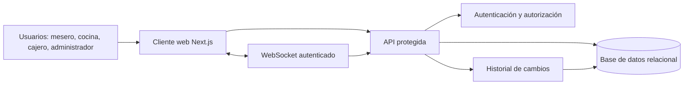

# Arquitectura de Orderix

El cliente web consume la API para las operaciones de autenticación, usuarios,
pedidos y menú. La API valida permisos por rol y persiste los datos en una base
relacional. El canal WebSocket exige autenticación en el handshake y distribuye
avisos de pedidos y chat a los usuarios autorizados.
