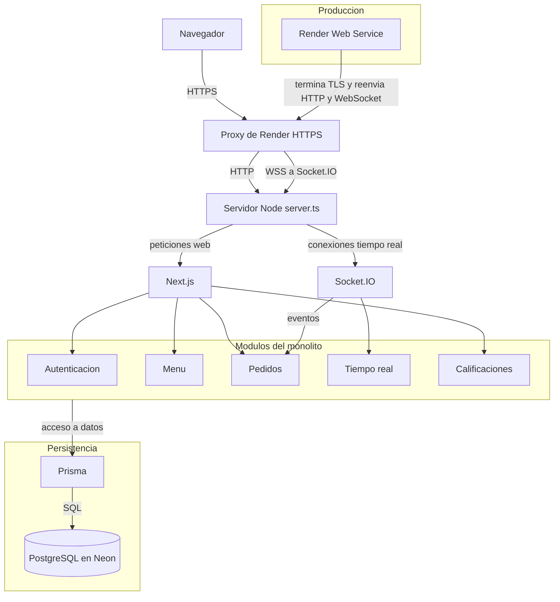
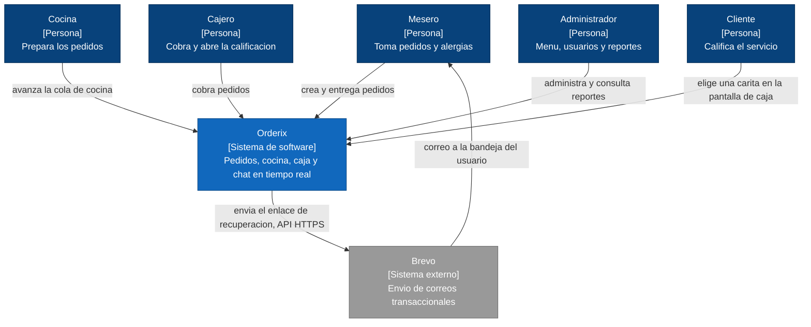
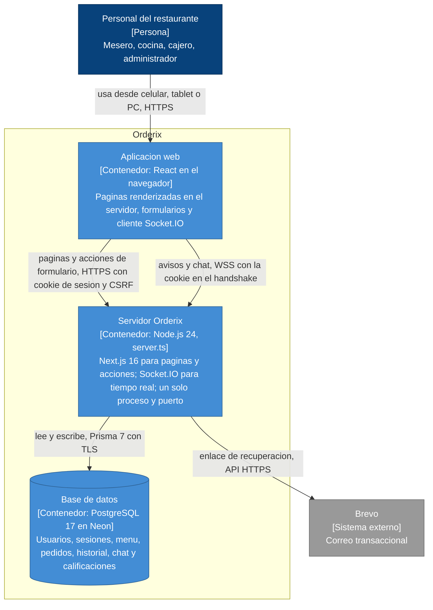
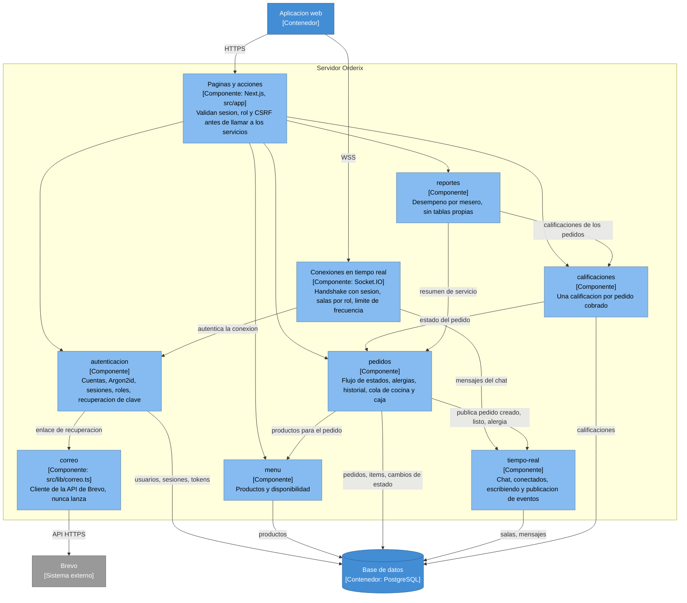

# Arquitectura del monolito de Orderix

<!-- mermaid-checked: no \n, no em-dash/en-dash, no {} in labels, subgraphs are id["label"], arrows are -->|"label"|, all subgraphs closed by end, ids unique -->

Render termina HTTPS y acepta WSS en su proxy; el servicio Node recibe el
tráfico reenviado y conserva el mismo puerto interno para HTTP y WebSocket.
Dentro de `server.ts`, la configuración de Next.js y la de Socket.IO están
separadas: Next.js atiende las peticiones HTTP y Socket.IO administra el
endpoint `/socket.io` y sus upgrades. Prisma conecta los módulos con
PostgreSQL, alojado en Neon en producción. La aplicación utiliza una única
base de datos PostgreSQL.

## Modelo C4

Tres niveles de zoom del [modelo C4](https://c4model.com): quién usa el
sistema y con qué se conecta (contexto), en qué piezas desplegables se divide
(contenedores) y cómo se organiza el servidor por dentro (componentes).

### Nivel 1: contexto

### Nivel 2: contenedores

En producción el servidor corre en un contenedor Docker en Render, que termina
HTTPS en su proxy y reenvía HTTP y WebSocket al mismo puerto interno.

### Nivel 3: componentes del servidor

Cada módulo de `src/modules` es un componente con su API pública en
`index.ts`. Las flechas son llamadas a esa API (ESLint impide importar el
interior de otro módulo) y ningún módulo consulta las tablas de otro.

`reportes` no tiene tablas: compone `resumenDeServicio` de `pedidos` y
`calificacionesDePedidos` de `calificaciones`. Todos los módulos (salvo
`autenticacion`) reciben el usuario de la sesión desde `autenticacion` para
volver a comprobar el permiso. En el segundo bimestre, cada componente con
tablas propias puede pasar a ser un contenedor (microservicio) con su base.
