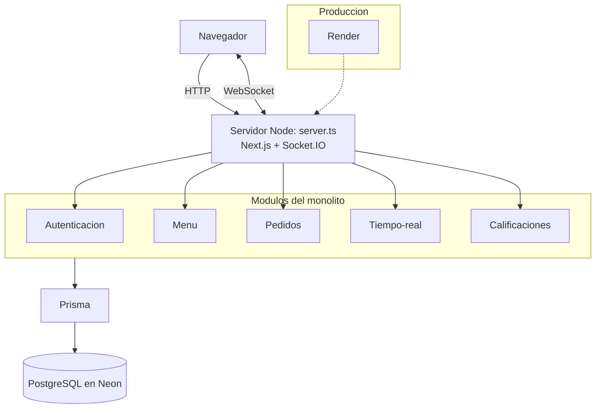

# Arquitectura del monolito de Orderix

El monolito se despliega en Render. El mismo proceso de `server.ts` ejecuta
Next.js y Socket.IO; Prisma conecta los módulos con PostgreSQL, alojado en Neon
en producción. La aplicación utiliza una única base de datos PostgreSQL.
