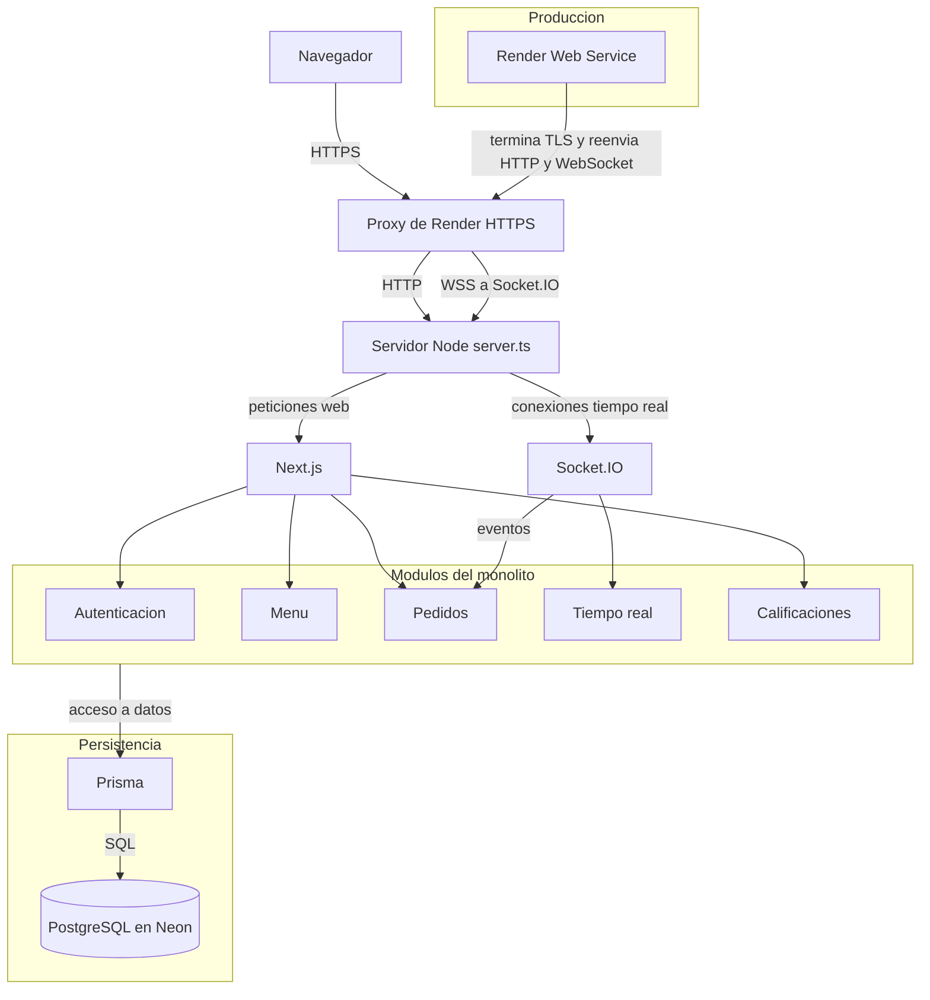

# Arquitectura del monolito de Orderix

<!-- mermaid-checked: no \n, no em-dash/en-dash, no {} in labels, subgraphs are id["label"], arrows are -->|"label"|, all subgraphs closed by end, ids unique -->

Render termina HTTPS y acepta WSS en su proxy; el servicio Node recibe el
tráfico reenviado y conserva el mismo puerto interno para HTTP y WebSocket.
Dentro de `server.ts`, la configuración de Next.js y la de Socket.IO están
separadas: Next.js atiende las peticiones HTTP y Socket.IO administra el
endpoint `/socket.io` y sus upgrades. Prisma conecta los módulos con
PostgreSQL, alojado en Neon en producción. La aplicación utiliza una única
base de datos PostgreSQL.
