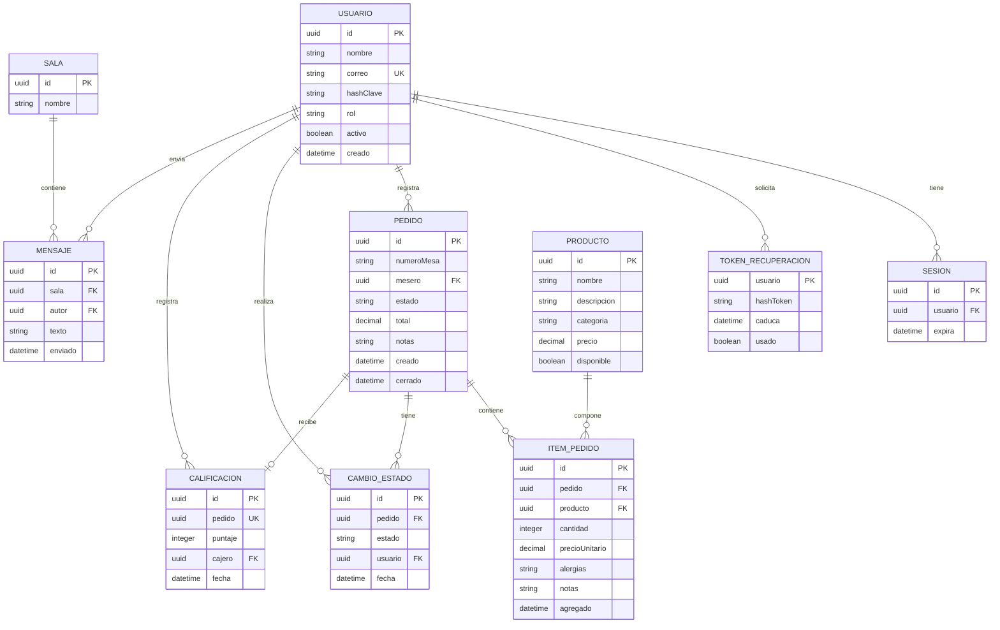

# Modelo entidad-relación de Orderix

La relación entre `PEDIDO` y `CALIFICACION` es opcional y uno a uno:
un pedido tiene como máximo una calificación. Un pedido puede tener muchos
ítems y muchos cambios de estado.
